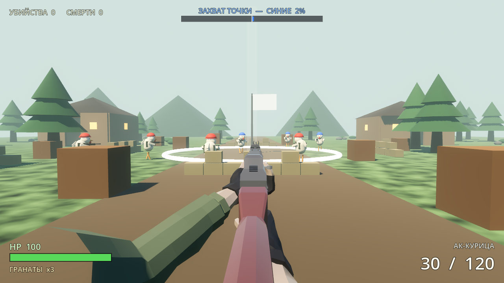
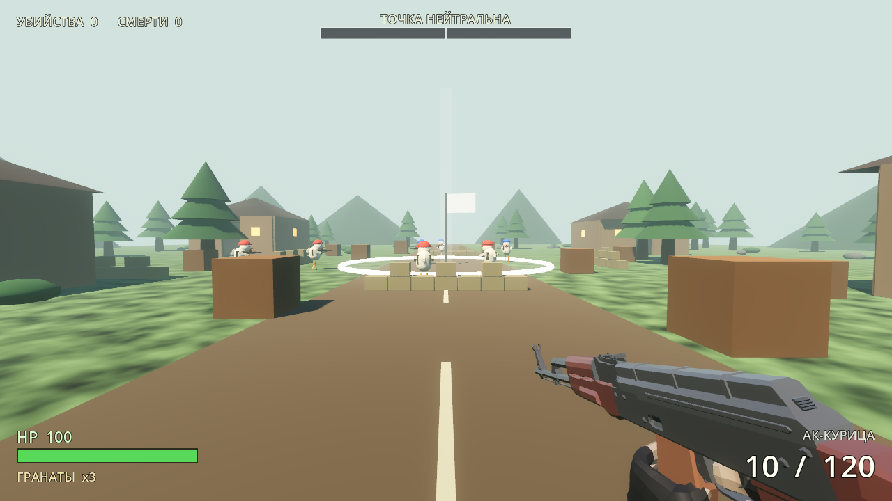

# Chicken War — Godot 4 FPS prototype

A small single-player Chicken War–style FPS built with **Godot 4.7** and Forward+ rendering.

You play as an armed chicken fighting a squad of rival chickens for control of the capture point in the middle of the map.

## Features

- First-person controller with sprint, crouch, jump, mouse look, and ADS
- Low-poly AKM viewmodel with arms, textures, and `Idle` / `Shoot` / `Reload` animations
- Procedural audio for gunshots, reloads, hitmarkers, distant bot fire, and grenade explosions
- Hit-scan rifle with recoil, spread, tracers, muzzle flash, and headshots
- Frag grenades with physics and area damage
- AI chicken squads that patrol, shoot, and contest the capture point
- Capture-point progress bar, kill/death stats, health, ammo, and hitmarker HUD
- Procedural low-poly map with buildings, trees, crates, and a central objective

## Controls

| Input | Action |
| --- | --- |
| `WASD` | Move |
| Mouse | Look |
| `Shift` | Sprint |
| `Ctrl` / `C` | Crouch |
| `Space` | Jump |
| Left mouse | Fire |
| Right mouse | Aim down sights |
| `R` | Reload |
| `G` | Throw grenade |
| `Esc` | Pause / resume |

The game starts from the main menu. Click or press `Enter` to capture the mouse and begin.

## Running

1. Install [Godot 4.7](https://godotengine.org/download/) or newer.
2. Open `project.godot` in the editor.
3. Press `F5`.

The project also supports headless validation:

```powershell
godot --headless --path . --quit-after 120 -- --test
```

## Screenshots






## Credits

- **AKM FPS Rig** and **AKM** by **J-Toastie** — [Poly Pizza](https://poly.pizza/m/U6l6wjxFhC), licensed under [CC-BY 3.0](https://creativecommons.org/licenses/by/3.0/). See [CREDITS.md](CREDITS.md).
- Made with [Godot Engine](https://godotengine.org/) (MIT).

All other game code, level geometry, chickens, and UI were created for this prototype.
